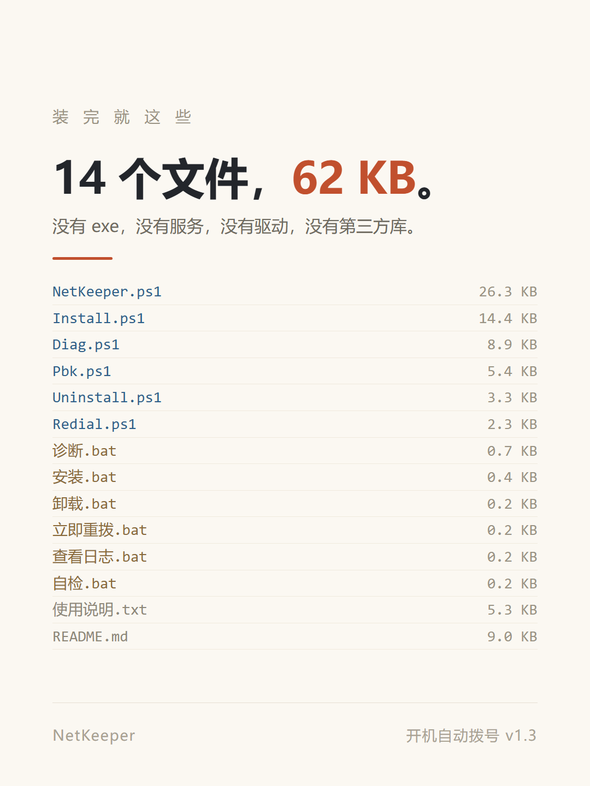

# NetKeeper · 开机自动拨号

> 一个 34 KB 的小工具，解决一件小事：**开机不用再点「宽带连接」**。

[](#兼容性)
[](#兼容性)
[](#它为什么这么小)
[](LICENSE)


---

## 起因

光猫桥接、电脑自己 PPPoE 拨号的宽带，开机之后得进桌面、双击「宽带连接」、等三秒、点「连接」。

每天一次。忘了拨，浏览器转半天圈才反应过来；半夜断电恢复、远程连回来，机器开着但没网。

这件事小到不值得装一个软件，所以我先去找现成的办法——四种都差一口气：

| 办法 | 差在哪 |
|---|---|
| 快捷方式丢进启动文件夹 | 要**登录后**才执行，登录界面阶段没网；会弹窗；失败一次就再也不管 |
| Internet 选项「始终拨默认连接」 | 新版 Windows 上时灵时不灵，依赖「默认连接」这个概念，多网卡机器行为难料 |
| 自己配计划任务 | 可行，但要懂 `rasdial`、电话簿路径、SYSTEM 看不到用户连接，还要自写断线检测——**每台机器重配十几遍** |
| 让光猫/路由器拨号 | 最省事，但那是另一套网络结构；桥接是装维设好的，改它要动光猫配置 |

这个项目填的是「Windows 自带能力够用，但没有任何一个地方能一次配好」这道缝。

## 它能做什么

- **开机就拨，不等登录** —— 计划任务在系统启动时以 SYSTEM 身份执行，登录界面还没出现就已连上
- **掉线自动重拨** —— 每 10 秒查一次状态，断了立刻拨；失败按 2 → 3 → 5 → 8 → 12 → 20 → 30 秒退避
- **认得出「僵尸连接」** —— 显示已连接、实际没网的，连续两轮探测不通就挂断重拨；一小时内最多踢 3 次，避免把账号拨锁
- **不会自己打起来** —— 单实例锁，重复触发时后来的直接退出
- **出事能查** —— 日志按天分文件、精确到毫秒；`诊断.bat` 一键导出七段报告
- **六个双击就够** —— 安装 / 卸载 / 立即重拨 / 查看日志 / 自检 / 诊断

## 三步安装

1. 双击 **`安装.bat`**，UAC 点「是」
2. 选连接（一般直接回车 = `宽带连接`）
3. 输入宽带账号、密码（输入时不显示字符，正常）

看到「拨号成功」就好了。之后开机会自动拨，不用管。

> 升级：重跑 `安装.bat`，会认出旧配置并问「沿用这个账号密码？」，回车即可。

## 兼容性

- **系统**：Windows 10 / 11（64 位），在 Windows 11 build 26100 上实测。只要系统自带的 PowerShell 5.1，不需要 .NET、VC 运行库
- **前提场景**：光猫桥接 + 电脑自己 PPPoE 拨号。**光猫或路由器拨号的不需要这个程序**
- **连接名无所谓**：安装时列出机器上的连接让你选
- **拨号引擎双路径**：优先 `rasdial.exe`，`RAS API` 兜底。详见 [为什么优先 rasdial.exe](#为什么优先-rasdialexe)

## 它为什么这么小

| | |
|---|---|
| 压缩包 | **34 KB**（14 个文件） |
| 安装后 | **62 KB** |
| 依赖 | 无。PowerShell 5.1、RAS、计划任务，全是系统自带 |
| 没有 | exe、服务、驱动、托盘图标、第三方库、安装包框架 |



运行时只有一个 PowerShell 进程，闲时每 10 秒查一次状态，其余时间在睡觉。

## 安全设计

「能自动改系统网络设置的程序」天然值得被怀疑，所以这几条写清楚：

1. **密码不明文落盘** —— 输入的密码在内存里转成 AES-256-CBC 密文（16 字节随机 IV + 密文，整体 base64）写进 `config.json`；密钥是 32 字节随机数，单独存 `netkeeper.key`
2. **权限收紧到两组主体** —— 安装目录与两个文件的 ACL 只留 `SYSTEM` 与 `Administrators`，**关闭继承**（用 SID `S-1-5-18` / `S-1-5-32-544`，不用本地化名字）
3. **装在 `C:\ProgramData\` 而不是用户目录** —— 计划任务以 SYSTEM 跑脚本，脚本若在普通用户可写的位置，任何本地用户改一行就能在开机时拿到 SYSTEM 权限。放在 ProgramData 并锁死 ACL，这条路断了
4. **不联网、不上传、无遥测** —— 唯一网络行为是拨号本身，以及为判断连通性做的 TCP 53 / HTTP 探测。没有服务端，没有统计，没有更新检查
5. **全部明文脚本** —— 六个 `.ps1` 用记事本就能读完，不存在看不见的二进制
6. **已知取舍写在明面上** —— 见下
7. **卸载可逆** —— 注销任务、删安装目录、可选删除「所有用户」电话簿里复制的那条连接（删前自动备份）。不碰网卡、路由表、DNS

### 已知取舍

- **默认走 `rasdial.exe`，密码会出现在子进程命令行里**（仅管理员与开了 4688 审计的机器可见）。想避开就把 `config.json` 的 `"DialMode"` 改成 `"api"`，改走 Win32 RAS API，密码不进命令行；代价是部分机器上要回退。
- **杀软 / SmartScreen 可能提示** —— 行为特征（bat 提权 + 未签名 ps1 + 注册计划任务）和恶意脚本有重合。源码全公开，可以自己读完再决定。
- **没有 GUI、没有托盘** —— 刻意不做。目标就是开机拨号这一件事，做完退场。

## 为什么优先 rasdial.exe

实测在这台机器上，`RasDialW` 恒定返回 **87（ERROR_INVALID_PARAMETER）**，而不是应有的 623（连接不存在）。排查过：结构体尺寸（`Marshal.SizeOf(RASDIALPARAMS)` = 2120，与 x64 原生布局一致）、手工按字节布局、8 种 `dwSize`、显式入口名、32 位进程——全是 87。

同进程里 `RasValidateEntryNameW` 正常，但传 null 电话簿时返回 621、`RasEnumEntries` 返回 50 —— 根因指向**默认电话簿缺失**（`C:\ProgramData\Microsoft\Network\Connections\Pbk\rasphone.pbk` 不存在）。

所以设计成双路径：API 优先，遇到 `87 / 50 / 621` 就判定「这套 API 在当前系统用不了」，整个会话降级到 `rasdial.exe`，日志里明确写「本机将用：rasdial.exe 兜底」。

## 文件结构

运行文件全部平铺在根目录，因为 `安装.bat` 按「同目录」找其他文件：

```
NetKeeper.ps1       守护进程：拨号 / 探活 / 重拨 / 单实例锁 / 日志   (532 行)
Install.ps1         安装器：查连接 → 录密码 → 装文件 → 设 ACL → 注册任务
Pbk.ps1             电话簿读写（判 UTF-16、拆分小节、增删连接、ACL 工具）
Redial.ps1          断开重拨（供 bat 调用）
Uninstall.ps1       卸载
Diag.ps1            七段诊断报告
安装.bat 等 6 张     双击入口（纯 ASCII + CRLF）
使用说明.txt         小白版三步图解
tools/check-calls.ps1   AST 级检查：命令调用是否都能解析（维护用）
docs/img/            README 用的图
```

## 排错

出问题先双击 **`诊断.bat`**，它会把七段信息打印出来并存到桌面 `NetKeeper诊断.txt`。

| 码 | 含义 | 处理 |
|---|---|---|
| `691` | 账号或密码错 | 重跑 `安装.bat`，重输密码 |
| `623` | 找不到连接 | SYSTEM 看不到你的连接；重跑安装会把连接复制到「所有用户」 |
| `651` / `678` | 猫或线路 | 重启光猫，确认网线在 WAN 口 |
| `769` | 指定端口不可达 | 网卡未就绪，程序会自动重试 |
| `87` | API 参数无效（本机特有） | 已知问题，自动降级 rasdial |

日志：`C:\ProgramData\NetKeeper\logs\keeper-YYYYMMDD.log`

## 开发

两个编码铁律，违背了脚本会「一行都不执行」：

1. **`.ps1` 必须 UTF-8 带 BOM**。PowerShell 5.1 读无 BOM 的 UTF-8 会按 GBK 解码，中文注释变乱码 → here-string 边界失效 → 报上百个语法错误（实测同一内容无 BOM 报 142 处）。改完务必复核：

   ```powershell
   $e = $null
   [void][Management.Automation.Language.Parser]::ParseFile($path, [ref]$null, [ref]$e)
   $e.Count   # 必须为 0
   ```

2. **`.bat` 必须纯 ASCII + CRLF**。cmd 按当前代码页解析 bat，中文文件名会被解码成乱码（`诊断.ps1` → `璇婃柇.ps1`），双击毫无反应。

改完跑一遍调用检查（catch 函数重命名后漏改调用点这类错）：

```powershell
powershell -NoProfile -ExecutionPolicy Bypass -File tools\check-calls.ps1
```

### 本地验证（不需要管理员、不改系统）

```powershell
powershell -NoProfile -ExecutionPolicy Bypass -File NetKeeper.ps1 -Selftest
```

会实测 RAS API、`rasdial.exe`、TCP 探测，并打印「本机将用：…」，不读密码、不改系统。

## 更新记录

见 [CHANGELOG.md](CHANGELOG.md)。当前 v1.3。

## 许可

[MIT](LICENSE)。
